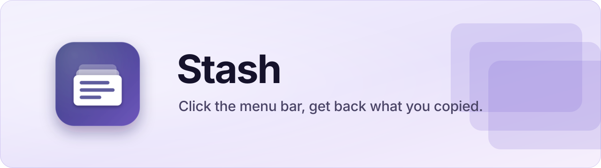
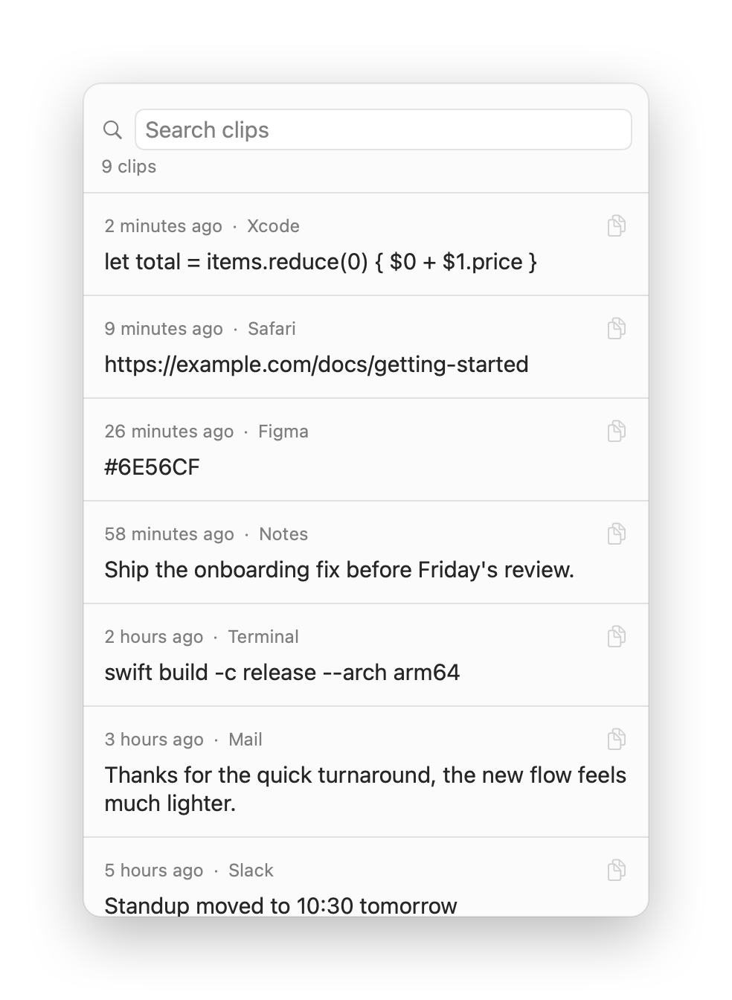

<p align="center">
  
</p>

<p align="center">
  
  
  
  
  
</p>

Clipboard history for macOS, in the menu bar. Everything you copy is kept in a list. Click the icon, click a row, it is on your clipboard again. Free, fully local, zero permissions.

Built because every free clipboard manager either skips Apple's review or sells contact data.

<p align="center">
  <picture>
    <source media="(prefers-color-scheme: dark)" srcset=".github/stash-panel-dark.png">
    
  </picture>
</p>

## Features

- **Left click** opens the history, **right click** opens the menu (Open at Login, Clear History, Quit).
- **Search** across the 200 newest clips. The cursor starts in the search field, so type-then-Enter copies the first match.
- **Click a row** to copy it back. **Right-click a row** to delete it.
- **Password-manager aware**: clips flagged `org.nspasteboard.ConcealedType` (1Password, Bitwarden, the macOS Passwords app) are refused, never stored.
- **30-day expiry**: older clips are dropped at launch, so a stray secret cannot sit on disk forever.
- **Zero permissions**: reading your own clipboard needs no TCC grant. Any permission prompt from Stash is a red flag.
- **Owner-only storage**: `history.log` is `0600` inside a `0700` directory.

## How it works

macOS has no clipboard-changed notification, so `ClipboardMonitor` polls `NSPasteboard.changeCount` every 0.5 s. It is a cheap integer read, so the cost is not measurable. Clips are appended to a tab-separated `history.log`; the popover reads only the tail of the file, so load time stays flat as the log grows.

| File | Role |
|---|---|
| `ClipboardMonitor.swift` | Polls `changeCount`, filters concealed and transient types, skips its own writes |
| `HistoryStore.swift` | Append-only log, tail read, per-row delete, 30-day prune |
| `HistoryPanel.swift` | The popover: search, rows, click-to-copy, copied toast |
| `AppDelegate.swift` | Status item, popover, right-click menu, launch at login |
| `Diagnostics.swift` | Append-only event trace |

**Two things that bite.** Copying from inside Stash bumps `changeCount`, which would re-record the clip you just restored; the monitor is told which change it caused and skips exactly that one. And ad-hoc signing breaks launch-at-login, because `SMAppService` identifies the app by its code signature and ad-hoc signing produces a new hash per build. `build.sh` signs with a persistent self-signed identity when one exists.

## What the filter does not catch

A password you select and copy by hand out of a visible field, a browser password manager that does not set the concealed flag, or a 2FA code pasted from a message. The real protection for those is the 30-day expiry and per-row delete, not the filter.

## Install

Requires an Apple Silicon Mac on macOS 26 and the Swift 6 toolchain (Xcode 26).

```bash
git clone https://github.com/ramy441/stash.git && cd stash
./build.sh --install        # builds, signs, copies to /Applications
```

To keep Open at Login working across rebuilds, create a code-signing certificate named **Murmur Local Signing** in Keychain Access (Certificate Assistant › Create a Certificate, type *Code Signing*). Without it, `build.sh` falls back to ad-hoc signing and warns you.

**Uninstall:** `./uninstall.sh` removes the app and keeps your history. Pass `--purge` to delete the history too.

## Deliberately not included

- **Images and files.** Text only. Storing copied images means a folder of your screenshots on disk forever.
- **Sync of any kind.** The entire point is that nothing leaves the Mac.

## Diagnostics

`~/Library/Application Support/Stash/` holds `history.log` (every clip, tab-separated with timestamp) and `events.log` (launches, skipped-secret counts, write failures).

---

Built AI-first: designed and directed by me, implemented with Claude Code.

MIT, see [LICENSE](LICENSE).
